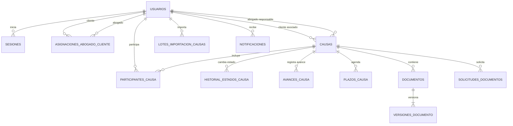

# PostgreSQL — LEX-CORPUS

Define una contraseña exclusivamente local y levanta el servicio:

```sh
read -s POSTGRES_PASSWORD
export POSTGRES_PASSWORD
docker compose up -d --wait
```

PostgreSQL 17 queda disponible en `localhost:55432`, con base y usuario `lex_corpus`. `POSTGRES_PASSWORD` es obligatoria y también debe reflejarse en `DATABASE_URL` del backend. Cambiar esa variable después de crear el volumen no modifica la contraseña existente.

El puerto se publica solo en loopback y usa un volumen persistente independiente de otros proyectos. No se ejecutan migraciones automáticamente al arrancar el contenedor.

Fuente de verdad del esquema: `../Sistema Aplicacion/lex-corpus-backend/migrations/`. Ejecuta `npm run db:migrate` desde el backend. Las migraciones se registran en `schema_migrations` y se ejecutan dentro de una transacción. No mantengas copias SQL duplicadas en esta carpeta.



El diagrama utiliza nombres en español para facilitar su presentación. En las migraciones y en PostgreSQL las tablas conservan sus identificadores técnicos en inglés.

La migración `004_domain_hardening.sql` lleva el modelo inicial a 14 tablas funcionales. Conserva el abogado y cliente principal en `cases` para no romper la aplicación, pero añade `lawyer_client_assignments` con historial temporal y `case_participants` para colaboradores u observadores.

También incorpora:

- plazos y recordatorios (`case_deadlines`);
- documentos, metadatos y versiones con checksum SHA-256 (`documents`, `document_versions`);
- solicitudes documentales al cliente (`document_requests`);
- notificaciones y tokens de recuperación de contraseña;
- historial de estados y bitácora de auditoría sin almacenar hash de contraseña ni notas internas;
- sesiones revocables, bloqueo temporal por intentos fallidos y fecha de último acceso;
- triggers que validan roles, cartera abogado-cliente y sincronizan participantes, aun si una escritura no pasa por la API.

No se habilitó Row-Level Security porque el backend utiliza una única cuenta técnica sin propagar la identidad del usuario a PostgreSQL. Activarla bajo ese diseño rompería el acceso o produciría una protección aparente. La autorización por usuario sigue en la API, mientras la base aplica integridad y trazabilidad.

La migración `003_supervision.sql` añade el rol `SUPERVISOR`, el último avance de gestión en `cases` y `case_progress_events` con autor, etapa, resumen, próxima acción, fecha y versión de causa. Las causas anteriores conservan sus datos y comienzan sin avance informado. Una sentencia SQL guarda avance e historial de forma atómica. Este historial registra avances explícitos; no constituye una auditoría de todas las modificaciones de la causa.

La migración `005_session_inactivity.sql` hace obligatoria la marca `sessions.last_seen_at`, valida que no sea anterior a la creación de la sesión y añade un índice parcial para localizar sesiones activas inactivas. Esto permite que el servidor aplique el cierre por inactividad, incluso si el temporizador del navegador fuese alterado.

La migración `006_case_imports.sql` incorpora `case_import_batches`, asociada al abogado propietario. Conserva temporalmente el archivo procesado como encabezados y filas JSON, el mapeo de columnas, el estado de la importación y su vencimiento. Cada lote acepta entre 1 y 500 filas y solo puede ser consultado y confirmado por el abogado que lo creó.

## Inventario de migraciones

| Archivo | Propósito principal |
|---|---|
| `001_initial.sql` | Usuarios, sesiones y causas. |
| `002_case_version.sql` | Control de versión para edición concurrente de causas. |
| `003_supervision.sql` | Coordinación jurídica y seguimiento de avances. |
| `004_domain_hardening.sql` | Cartera de clientes, participantes, documentos, plazos, notificaciones y auditoría. |
| `005_session_inactivity.sql` | Control servidor de la inactividad de sesiones. |
| `006_case_imports.sql` | Lotes temporales para importar causas desde Excel. |

El modelo vigente contiene 15 tablas funcionales, además de `schema_migrations`, utilizada para registrar las migraciones aplicadas.

## Contenido de esta evidencia

- `compose.yaml`: servicio PostgreSQL reproducible para desarrollo y pruebas.
- `README.md`: arquitectura, relaciones, controles de integridad y procedimiento de ejecución.
- Migraciones SQL: se mantienen como fuente única en `../Sistema Aplicacion/lex-corpus-backend/migrations/` para evitar copias divergentes.

Los datos de demostración son ficticios. No se incluyen archivos `.env`, contraseñas de producción, respaldos con información personal ni volúmenes locales de PostgreSQL.
